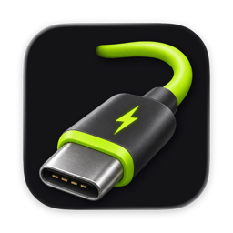
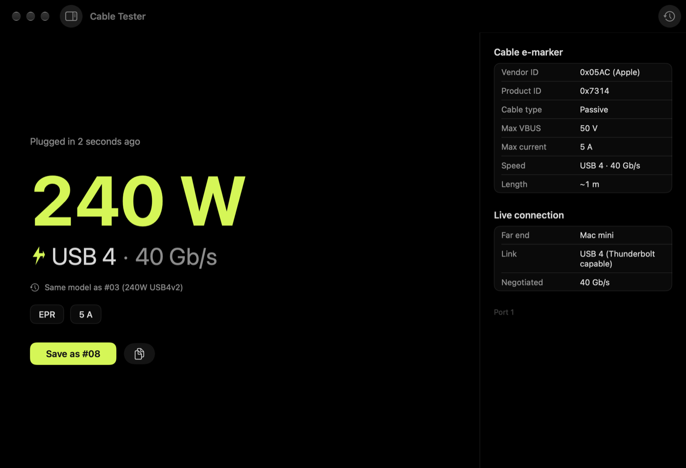
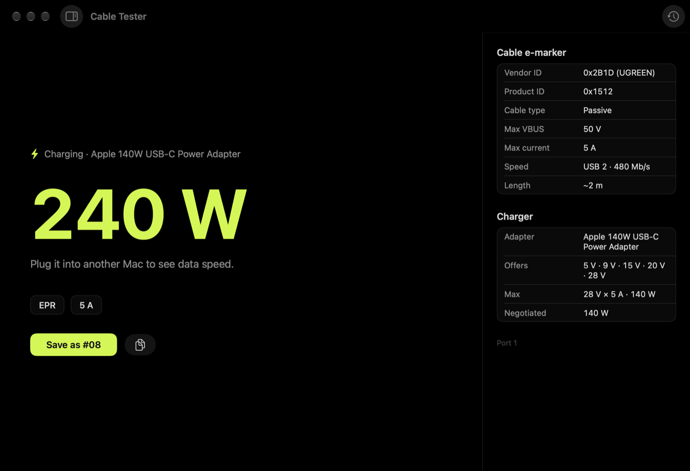
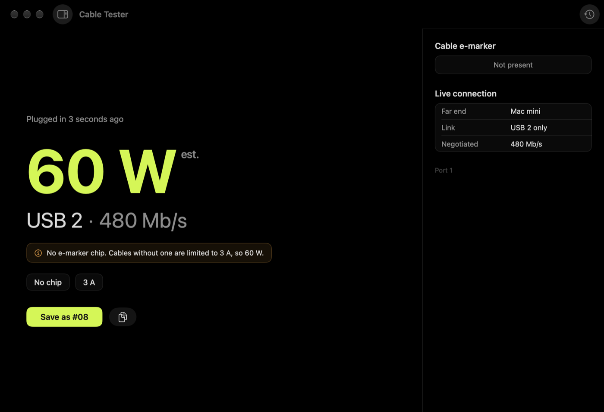
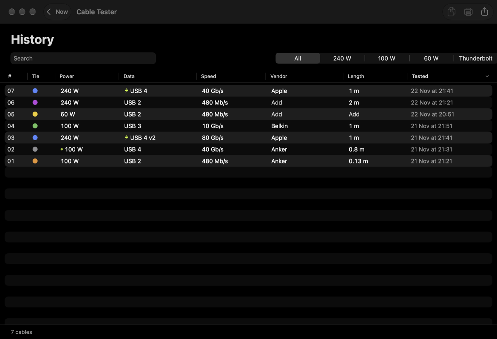
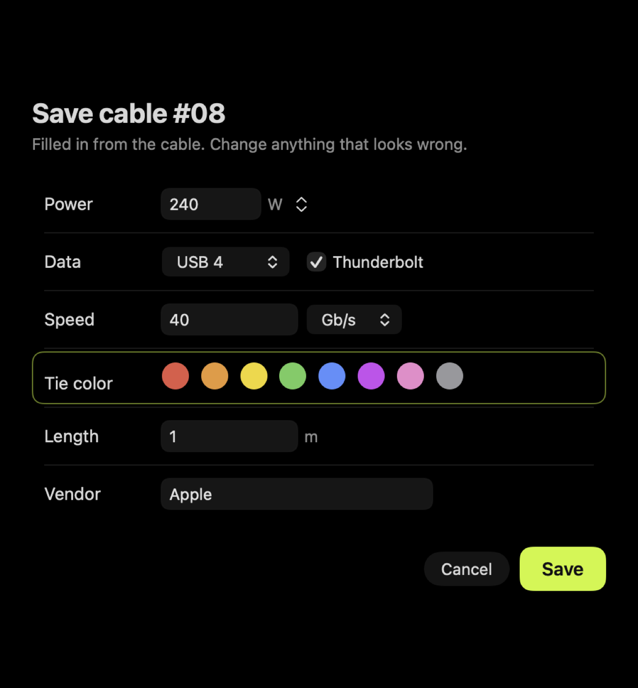

<div align="center">



# Cable Tester

**Plug in a USB-C cable. See its wattage and data speed.** A small native Mac app that reads the
chip inside the cable, so you can label a drawer of cables without a hardware tester.

[](#requirements)
[](CableKit)
[](App)
[](CableKit/Tests)



</div>

## What it shows

| Plugged into | Shows |
|---|---|
| **Another Mac** | Watts, USB generation, live speed (Thunderbolt icon when the link is Thunderbolt), chip data |
| **Any small USB-C device** (earbuds case, flash drive) | Watts and rated speed from the cable's chip. The live speed is the device's, and the app says so. |
| **A charger** | Watts only. Data speed is hidden: there is no data link. |
| **Nothing** | "Plug in the other end": the Mac sees the cable but cannot read it yet |

Cables without a chip are basic USB 2 cables limited to 3 A, so they show **60 W est.** plus whatever
speed the live link reaches.

<table>
<tr>
<td></td>
<td></td>
</tr>
<tr>
<td></td>
<td></td>
</tr>
</table>

## How it works

- **The cable's chip (e-marker).** USB-C cables rated for 5 A or fast data carry a chip that reports
  their current, voltage, speed and length. macOS exposes it in the IORegistry (`SOP'` under each
  USB-C port), and the app decodes it. Details and bit layout: [docs/emarker.md](docs/emarker.md).
- **The live link.** Each port lists its active transports (USB 2, USB 3, USB 4/Thunderbolt) with the
  negotiated speed and the name of the device at the other end.
- **The charger.** On a MacBook, the charger's offer list (`AdapterDetails`) shows whether it offers
  5 A or 28 V, which it only does when the cable allows it.
- The app listens for IOKit plug events, so the result appears the moment a cable goes in.

There is no serial number in a cable, so the app can only say "same model as #03". Number labels and
coloured cable ties tell identical cables apart.

## Install

Download the latest DMG from [cable-tester-releases](https://github.com/loftspace/cable-tester-releases/releases/latest),
open it and drag **Cable Tester** into Applications. It is signed and notarized. The app updates
itself (Sparkle): it checks once a day, and **Cable Tester → Check for Updates…** checks now.

## Using it

1. Plug the cable into the Mac, then the other end into a charger, another Mac or any USB-C device.
   A checklist ticks off each end; cables that were already connected when the app started are
   ignored until you replug them.
2. Read the result once both ends are in. Press **Save** (⌘S): the sheet is prefilled from the cable; add the tie colour
   and anything else you know. Empty fields stay blank.
3. Write the label (`#07 240W USB4`) on the cable. The copy button puts it on the clipboard.
4. **History** (⌘Y): every field is editable in place, with filters for 240/100/60 W and Thunderbolt,
   label copy and print, and CSV export.

Saved cables live in `~/Library/Application Support/Cable Tester/cables.json`. On first run the
prototype's CSV log (`~/Documents/Claude/zz-Misc/cable-tester/cables.csv`) is imported.

## Requirements

- Apple Silicon Mac, macOS 15 or later.
- Charger readings need a Mac with a battery (MacBook). The cable chip and the live link work on any
  Mac, including a Mac mini.

## Building

```sh
xcodegen generate                       # creates CableTester.xcodeproj from project.yml
xcodebuild -project CableTester.xcodeproj -scheme CableTester -configuration Debug \
  -derivedDataPath build/dd build
(cd CableKit && swift test)             # logic tests, with real readings as fixtures
```

Headless modes, no window opened:

```sh
APP="build/dd/Build/Products/Debug/Cable Tester.app/Contents/MacOS/Cable Tester"
"$APP" --probe                # print what every USB-C port shows right now
"$APP" --snapshot out/        # render every screen from demo data to PNGs
"$APP" --demo nochip          # run on demo data: empty, mac, charger, nochip, cableonly, device, history
```

## Releasing

Bump `MARKETING_VERSION` and `CURRENT_PROJECT_VERSION` in `project.yml` in the PR, merge, then on a
clean `master`:

```sh
scripts/release.sh --notes notes.md     # build, sign, notarize, DMG, publish, update the feed
scripts/release.sh --dry-run            # everything up to the notarized DMG, nothing published
```

## Project layout

| Path | What |
|---|---|
| [CableKit](CableKit) | Decoding, rules and storage, no UI. Fully unit tested. |
| [App](App) | SwiftUI app, IOKit port monitor, demo and snapshot modes |
| [docs/app-spec-and-plan.md](docs/app-spec-and-plan.md) | The spec this app follows |
| [docs/emarker.md](docs/emarker.md) | Reading the cable chip on macOS, with test results |
| [scripts/release.sh](scripts/release.sh) | Release: signed, notarized DMG and the Sparkle update feed |
| [cable_tester.py](cable_tester.py) | The original command-line prototype |
| `.impeccable/mocks` | Approved design mockups |

## Prototype (command line)

The original script still works: `./cable_tester.py` tests cables one by one from the terminal and
logs to CSV; `./cable_tester.py --read` shows the current charger offers and links once.
